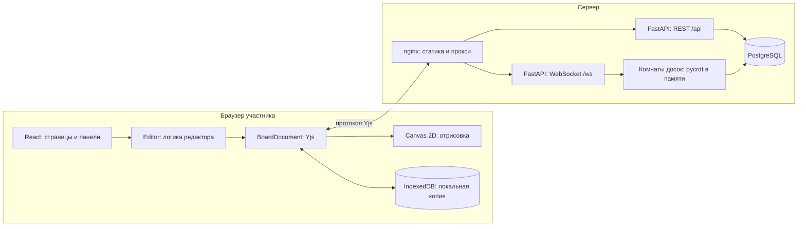
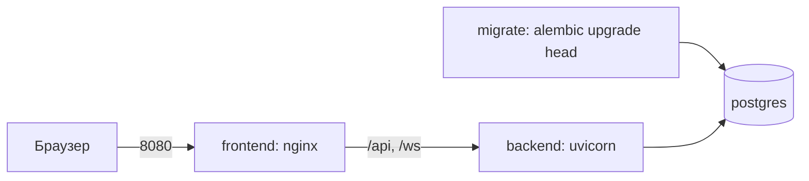

# Архитектура Whatever

Документ описывает, как устроено приложение сейчас и почему выбраны именно такие решения.
Подробное техническое задание и план развития — в концепции проекта.

## Общая схема

Все сервисы поднимаются одной командой `docker compose up` на сервере заказчика
(подробнее — в разделе «Развёртывание»).

## Модель данных доски

Доска — документ [Yjs](https://docs.yjs.dev) (CRDT). Каждый элемент хранится в своём `Y.Map`
внутри общего `Y.Map("elements")` и знает id своей страницы (`page`):

- фигура: вид из каталога (`src/model/shapes.ts`) или `path` (рукописный штрих) с рамкой
  `x, y, w, h`, текстом, цветами и порядком `z`;
- картинка (`image`) и карточка вложения (`file`): та же рамка и ссылка на файл доски
  (`file`: id, имя, размер, тип), а сам файл лежит на сервере (см. «Файлы досок»);
- стрелка: два конца, каждый — свободная точка или привязка к фигуре (`shapeId`), вид линии
  `route` (`straight` или `elbow`), наконечники `startHead` и `endHead` (обычные стрелки,
  обозначения UML и «воронья лапка» ER), пунктир `dashed` и подпись `text`.

Страницы лежат в `Y.Map("pages")`: название и порядок `order`. Порядок — дробное число,
поэтому перестановка вкладки меняет одно поле одной страницы, и одновременные перестановки
не конфликтуют. Пока у доски одна страница, она не записана в документ: так выглядят доски,
нарисованные до появления страниц, а их элементы без поля `page` лежат на ней.

**Каталог фигур.** Для каждого вида фигуры каталог описывает контур, линии поверх заливки,
где стоит текст (по центру, секциями класса, заголовком контейнера), как в фигуру попадает
указатель и куда цепляются стрелки. Контур рисуется в интерфейс `PathSink`: ему удовлетворяет
и контекст Canvas, и построитель SVG-пути, поэтому фигура на доске и её иконка на панели
рисуются одним кодом. Контейнеры (рамка, граница системы, дорожка) встают под остальные
фигуры и при перетаскивании везут то, что в них лежит. Стрелка, приведённая к линии жизни,
запоминает высоту в долях рамки (`anchor`), а не край фигуры.

Изломы ломаной стрелки не хранятся, а вычисляются из концов при каждой отрисовке
(`arrowPath` в `src/model/geometry.ts`): стрелка идёт по оси, вдоль которой центры фигур
разнесены сильнее, выходит и входит через обращённые друг к другу стороны и ломается
посередине. Поэтому она сама перестраивается, когда фигуру двигает кто угодно, и правки
не конфликтуют. Попадание курсора и рамка стрелки считаются по тем же отрезкам.

Так правки разных полей одного элемента от разных людей сливаются без конфликтов: один
двигает фигуру, другой меняет её текст, и оба изменения сохраняются. Типы описаны
в `frontend/src/model/types.ts`.

## Фронтенд

Слои зависят только от нижележащих:

| Слой | Папка | Что делает |
| --- | --- | --- |
| Модель | `src/model` | `BoardDocument` поверх Yjs, геометрия, поиск элементов под курсором |
| Распознавание | `src/recognition` | превращает штрих в фигуру или линию и выравнивает её |
| Редактор | `src/editor` | инструменты, выделение, перетаскивание, отмена, горячие клавиши; без React и DOM |
| Холст | `src/canvas` | камера, сетка, отрисовка кадра, события указателя; сцена `drawScene` рисует элементы и для экспорта, и для превью |
| Файлы | `src/files` | загрузка файлов доски, уменьшение больших картинок перед загрузкой |
| Совместная работа | `src/collab` | подключение к серверу, локальная копия, присутствие участников |
| Вход | `src/auth` | кто вошёл, страница входа до входа, возврат к ней при потере сессии |
| Интерфейс | `src/pages`, `src/ui` | страницы (списки досок с папками, окно «Поделиться», вход по ссылке), шапка с меню пользователя, панель инструментов, навигация |

`Editor` не знает о React и DOM: он получает события в экранных координатах и меняет
документ, камеру и выделение. Поэтому почти вся логика проверяется быстрыми юнит-тестами,
без браузера.

### Производительность

- Холст перерисовывается в `requestAnimationFrame` только при изменениях (флаг «грязного» кадра).
- Рисуются только элементы, попавшие в видимую область.
- `BoardDocument` держит неизменяемый снимок элементов и пересобирает его только после
  изменения документа, а не на каждый кадр или движение мыши.
- React перерисовывает панели, только когда меняется то, что они показывают
  (инструмент, выделение, масштаб), а не на каждое движение указателя.
- Положение курсора отправляется другим участникам не чаще 20 раз в секунду.
- Распознавание фигур работает в браузере и не нагружает сервер.

### Умное рисование

Инструмент «Рисование» работает в одном из двух режимов: с включённым «Умным рисованием»
каждый штрих распознаётся, с выключенным остаётся рукописным. Распознавание устроено так.
Штрих передискретизируется до 64 точек и сравнивается с идеальными прямоугольником, эллипсом,
ромбом, треугольником вершиной вверх и прямой. Ошибка подгонки — среднее расстояние точек
штриха до контура фигуры, вписанной в его рамку. Если она меньше порога, набросок заменяется
ровной фигурой:
почти квадрат становится квадратом, размер берётся у похожего соседа, центр выравнивается
по соседям, остальное ставится по сетке. Прямая у фигуры превращается в привязанную стрелку.
Замена — отдельный шаг отмены, поэтому первое Ctrl+Z возвращает рукописный вариант.

### Темы

Все цвета интерфейса — CSS-переменные в `src/ui/theme.css`, тёмная тема переопределяет их
под `data-theme="dark"`. Тема применяется до отрисовки приложения. Пока пользователь
не выбрал тему кнопкой в шапке, берётся тема системы. Цвета фигур по умолчанию хранятся
в документе одним значением, а на экране подменяются цветами текущей темы: у одного участника
доска светлая, у другого тёмная, и обе читаются.

## Совместная работа

Клиент — стандартный `y-websocket`, сервер реализует тот же протокол на `pycrdt`:

1. При подключении сервер отправляет вектор состояния, клиент досылает недостающие изменения
   и получает недостающие у себя.
2. Дальше каждое изменение рассылается остальным участникам комнаты.
3. Присутствие (имя, цвет, курсор, выделение) идёт через awareness и в документ не попадает.

**Работа без сети.** Документ хранится в IndexedDB, доска открывается сразу и редактируется
без связи. После переподключения протокол Yjs сам объединяет изменения, сделанные за это время.

**Чужим данным не доверяем.** Элементы документа и присутствие других участников приходят
по сети, поэтому проверяются при чтении (`src/model/validate.ts`): элемент с битыми полями
пропускается и не ломает доску у всех участников.

## Вход и права

Учётные записи свои: их создаёт администратор, внешних каталогов у заказчика нет. Способ
входа отделён от остального кода (`app/auth`), так что AD или Keycloak можно добавить позже,
не меняя доски и синхронизацию.

- **Пароли** хранятся в Argon2id. Хеширование идёт в отдельном потоке и не блокирует цикл
  событий. Для несуществующего логина проверяется заранее посчитанный хеш, поэтому время
  ответа не выдаёт, есть ли такой пользователь, а ответ одинаковый: «Неверный логин или пароль».
- **Сессия** — случайный токен в cookie `HttpOnly`, `SameSite=Lax` (и `Secure` за HTTPS).
  В таблице `sessions` хранится только SHA-256 токена: утечка базы не даёт войти.
  Срок 30 дней продлевается, когда прошла половина, так что база не пишется на каждый запрос.
- **Подбор пароля.** После 5 неудачных попыток за 15 минут для пары «адрес + логин» сервер
  отвечает 429 с `Retry-After` (пороги — в настройках). Счётчики в памяти процесса.
  Адрес пользователя бэкенду сообщает nginx, заменяя `X-Forwarded-For` своим, а не дополняя:
  иначе клиент подставил бы в заголовок любой адрес и обошёл бы ограничение. Если перед
  nginx стоит прокси с TLS, его адрес задаётся `WHATEVER_TRUSTED_PROXY`.
- **Заголовки браузеру.** nginx отдаёт строгую Content-Security-Policy (только свои скрипты,
  стили и подключения, без встраивания в чужие страницы), `Referrer-Policy: same-origin`,
  чтобы ссылки доступа не уходили на чужие сайты, и `nosniff`.
- **Запросы с чужих сайтов.** Изменяющие запросы и подключения WebSocket принимаются,
  только если `Origin` совпадает с `Host`. Это дополняет `SameSite`, который не защищает
  от соседних поддоменов. nginx и прокси Vite передают `Host` браузера без изменений.
- **Роли**: пользователь и администратор. Администратор не может заблокировать себя
  или снять с себя права, чтобы система не осталась без администратора.
- **Завершение сессий действует сразу.** Выход, блокировка и смена пароля удаляют сессии
  в базе и закрывают открытые по ним подключения к доскам (`app/sync/sockets.py`) с кодом
  4401. Клиент `y-websocket` после кодов 4400–4499 не переподключается, а приложение
  показывает страницу входа. При смене своего пароля подключения этого браузера остаются.
- **Без сети.** Cookie сессии недоступна из JavaScript, поэтому браузер запоминает последнего
  вошедшего пользователя (имя, логин, роль) и с ним открывает доски из локальной копии.
  Если сессия на самом деле истекла, сервер скажет об этом при подключении, а изменения,
  сделанные без сети, отправятся после повторного входа.

Первый администратор создаётся командой `python -m app.cli create-admin`.

### Права на доски

Доступ к доске — один из трёх уровней (`app/access.py`), каждый включает предыдущие:

| Уровень | Кто | Что может |
| --- | --- | --- |
| `view` | участник с правом «Просмотр» | смотреть доску и курсоры участников |
| `edit` | участник с правом «Редактирование» | менять содержимое и название |
| `manage` | владелец доски и администраторы | выдавать и отзывать доступ, удалять доску |

- **Где хранится.** `boards.owner_id` — владелец, `board_members` — участники с правом
  `viewer` или `editor`, `share_links` — ссылки. Папки (`folders`) личные: доску по ним
  раскладывает только владелец, а участники видят её в общем списке «Доступные мне».
  При обновлении до этой версии все существующие доски переходят к первому администратору.
- **REST.** Права проверяет зависимость `board_access(уровень)`: нет доски — 404, нет доступа —
  403 «Нет доступа к доске», не хватает уровня — 403 «Недостаточно прав».
- **Синхронизация.** Права проверяются при подключении к комнате, и у подключения есть флаг
  `can_edit`. От зрителя сервер принимает только запрос недостающего (шаг 1 синхронизации)
  и присутствие, а шаг 2 и обновления отбрасывает, не применяя и не рассылая. Так зритель
  не изменит доску, даже если обойдёт интерфейс.
- **Изменение прав действует сразу.** Выдача, смена и отзыв доступа, а также смена роли
  пользователя закрывают затронутые подключения с кодом 4100. Клиент переподключается сам,
  сервер проверяет права заново, а страница перечитывает их и включает или выключает
  режим просмотра. Если доступа больше нет, сервер закрывает подключение с кодом 4403,
  и клиент удаляет локальную копию доски из браузера. То же при удалении доски (4404).
- **Ссылки доступа.** Токен — 24 случайных байта, хранится как есть, чтобы ссылку можно было
  скопировать снова. Сама ссылка доску не открывает: по ней нужно войти, после чего
  пользователь становится участником. Право выдаётся одним `INSERT … ON CONFLICT`, поэтому
  двойное открытие ссылки не вызывает гонки, а более сильное право не понижается.
  Срок необязателен; истёкшие ссылки не работают (410) и удаляются при создании новых.
- **В интерфейсе** зрителю вместо панели инструментов показывается «Только просмотр»,
  а редактор (`Editor.setReadOnly`) не меняет документ ни одной командой. Это удобство,
  а не защита: защищает сервер. Права запоминаются в браузере для каждой пары «пользователь +
  доска», чтобы без сети доска открывалась в том же режиме. Пока права неизвестны,
  доска открывается только для просмотра.

## Бэкенд

| Модуль | Что делает |
| --- | --- |
| `app/api/auth.py` | вход, выход, текущий пользователь, смена своего пароля |
| `app/api/admin.py` | управление учётными записями, только для администраторов |
| `app/api/boards.py` | REST: список, создание, переименование, перенос в папку, удаление досок |
| `app/api/folders.py` | личные папки: создание, переименование, удаление с подъёмом содержимого |
| `app/api/sharing.py` | участники доски, ссылки доступа и вход по ссылке |
| `app/api/users.py` | справочник активных коллег для окна «Поделиться» |
| `app/api/files.py` | картинки и вложения: загрузка на доску и скачивание |
| `app/api/sync.py` | WebSocket `/ws/boards/{id}`: проверка входа и прав, подключение к комнате |
| `app/access.py` | уровни доступа и правила, по которым они вычисляются |
| `app/auth/` | пароли, сессии, защита от подбора, зависимости FastAPI для проверки входа и прав |
| `app/sync/room.py` | комнаты досок: документ в памяти, рассылка, запись в базу |
| `app/sync/sockets.py` | открытые подключения: чьи, по какой сессии и к какой доске, чтобы закрывать их при выходе, блокировке, смене прав и удалении доски |
| `app/files.py` | файлы досок на диске: запись по частям, определение типа по содержимому |
| `app/cli.py` | `serve` — запуск сервера с настройками, `create-admin` — первый администратор |
| `app/core/config.py` | все настройки: единственное место, где читается окружение |
| `app/core/db.py` | пул соединений и фабрика сессий (`Database`), зависимость `DbSession` |
| `app/core/logging.py` | единый журнал приложения и uvicorn: текст или JSON |
| `app/main.py` | `create_app(settings)`: сборка приложения, ресурсы на время его работы |
| `app/models.py` | таблицы `users`, `sessions`, `boards`, `board_updates`, `folders`, `board_members`, `share_links`, `board_files` |

Всё асинхронное: FastAPI, SQLAlchemy 2 с `asyncpg`, отдельный поток на запрос не нужен.

### Настройки и зависимости

Окружение читается в одном месте — классе `Settings` (`app/core/config.py`): база, вход,
синхронизация, журнал. Значения проверяются pydantic при запуске, поэтому опечатка
в `.env` останавливает сервер с понятной ошибкой, а не проявляется позже. Полный список
с пояснениями — в `.env.example`, и тест следит, чтобы он не расходился с классом.

Настройки читаются только в точках входа — `create_app`, командах `app.cli` и миграциях —
и дальше передаются явно. `create_app` при запуске создаёт `Database`, `RoomManager`,
`LoginThrottle` и `BoardSockets` с нужными параметрами и кладёт их в `app.state`,
обработчики получают их через зависимости FastAPI. Поэтому модули не читают глобальное
состояние, а тесты собирают приложение с любыми параметрами без подмены констант.

Параметры базы называются так же, как у образа postgres (`POSTGRES_*`): один пароль из `.env`
получают и сервер базы, и бэкенд. Адрес собирается через `URL.create`, так что пароль
может содержать любые символы.

### Хранение доски

Доска хранится как последовательность двоичных дельт Yjs в `board_updates`. При открытии
комнаты дельты применяются по порядку.

- **Запись пачками.** Изменения за 0,5 секунды объединяются (`merge_updates`) и пишутся одной
  строкой. Перетаскивание фигуры даёт десятки изменений в секунду; без пачек это были бы
  тысячи вставок в секунду при сотне участников.
- **Почему это безопасно.** Если сервер упадёт до записи пачки, изменения не потеряются:
  они есть у клиентов, и при переподключении клиент досылает серверу всё, чего у того нет.
  При штатной остановке сервер дописывает всё несохранённое.
- **Сжатие.** Когда последний участник уходит, а дельт накопилось больше 50, они заменяются
  одним снимком документа, и доска открывается быстрее. Если документ не загрузился
  (например, база была недоступна), сжатие не выполняется, чтобы не стереть историю.
- **Удаление доски.** Открытая комната отбрасывает несохранённые изменения (писать их уже
  некуда), а участники отключаются с кодом 4404.

### Файлы досок

Картинки и вложения хранятся на диске, в каталоге `WHATEVER_FILES_DIR` (в Docker — том
`files-data`), по пути `<id доски>/<id файла>`, а их описание — в таблице `board_files`.
id файла уникален в пределах доски: копия доски получит файлы под теми же id, и содержимое
доски переписывать не придётся.

- **Загрузка.** Файл приходит телом запроса `POST /api/boards/{id}/files` (имя — в заголовке
  `X-File-Name`) и пишется на диск по частям, без multipart и без файла целиком в памяти.
  Сначала он попадает во временный файл и получает своё имя, только когда принят целиком
  и записан на диск (`fsync`). Поэтому оборванная загрузка не оставит половину картинки,
  а сбой питания — запись в базе о файле, которого нет. Размер ограничен
  `WHATEVER_MAX_UPLOAD_MB`: заявленный `Content-Length` проверяется сразу, а поток —
  по ходу приёма. nginx тело запроса не копит, а сразу передаёт бэкенду.
- **Безопасность.** Тип файла определяется по первым байтам, а не по заголовку запроса.
  Картинкой считаются только PNG, JPEG, GIF и WebP: их браузер показывает, всё остальное
  (в том числе SVG) только скачивается. При скачивании стоят `nosniff`
  и `Content-Security-Policy: sandbox`, так что загруженная страница со скриптом
  не выполнится на адресе приложения.
- **Права.** Загружать может тот, кто правит доску, а смотреть и скачивать — любой участник.
- **Кэш.** Содержимое файла с данным id не меняется, поэтому браузер кэширует его на год,
  и картинки видны и без связи, если доску уже открывали.
- **Время жизни.** Файл живёт, пока жива доска: удалённая с доски картинка вернётся
  отменой или из старой версии. Файлы удаляются вместе с доской.
- **В браузере** большие картинки уменьшаются до 2048 пикселей по длинной стороне ещё
  до загрузки, а на холсте картинки загружаются при первой отрисовке и держатся в памяти.

### Конкурентность

`RoomManager` хранит открытые комнаты. Общая блокировка защищает только словарь комнат
и списки участников: загрузка доски из базы и отправка данных клиентам идут вне её,
поэтому медленная доска или медленный клиент не задерживают остальных. Новая сессия доски
ждёт, пока предыдущая допишет изменения в базу.

### Ограничения текущей версии

- Комнаты живут в памяти одного процесса, поэтому бэкенд запускается одним процессом
  `uvicorn`. Для 100 одновременных участников этого должно хватить, но нагрузочный тест
  ещё не проводился, он в плане. Для нескольких процессов
  или серверов комнаты будут обмениваться изменениями через Redis pub/sub; Redis добавится
  в `docker-compose.yml` вместе с этой работой. Счётчики попыток входа и реестр подключений
  тоже живут в памяти и переедут туда же.
- Название доски меняется через REST и у других участников обновляется при следующем открытии.
- Если редактора понизили до зрителя, пока он работал без сети, его неотправленные правки
  сервер не примет: они останутся только в его браузере.
- Владельца доски сменить нельзя. Доски заблокированного пользователя остаются у него,
  и управляют ими администраторы.

## Развёртывание

- **Порядок запуска.** `postgres` (healthcheck) → `migrate` применяет миграции и завершается →
  `backend` (healthcheck `/api/health`) → `frontend`. Бэкенд никогда не работает со старой
  схемой, а nginx не принимает запросы, пока бэкенд не готов.
- **Образы.** Многоэтапная сборка: инструменты сборки (uv, Node) остаются в первом этапе.
  Процессы работают не от root: бэкенд от uid 10001, nginx из образа `nginx-unprivileged`.
  Код бэкенда только читается; писать процесс может лишь в том `files-data`.
  `.dockerignore` по белому списку, поэтому `.env` и тесты в образ не попадут.
- **Остановка.** Бэкенд запускается без оболочки (`python -m app.cli serve`) и сам получает
  SIGTERM: закрывает подключения, дописывает изменения открытых досок и закрывает пул.
  `stop_grace_period` в 30 секунд с запасом покрывает это время.
- **Здоровье.** `/api/health` отвечает 200, когда база доступна, и 503, когда нет, не дольше
  2 секунд. Успешные проверки в журнал доступа не пишутся.
- **Журналы.** Приложение и uvicorn пишут в stderr в одном формате: текст или JSON
  (`WHATEVER_LOG_FORMAT`). Docker хранит до 5 файлов по 10 МБ на сервис.

Установка, HTTPS, обновление и резервные копии — в [docs/operations.md](docs/operations.md).

## Качество кода

Проверки запускаются в CI на каждый pull request; локально — `make check`.

| Часть | Проверки |
| --- | --- |
| Бэкенд | `ruff` (линтер с bandit и форматирование), `mypy --strict`, `pytest` на PostgreSQL с покрытием не ниже 90%, предупреждения считаются ошибками |
| Миграции | применение, откат и повторное применение на PostgreSQL 16; `alembic check`: модели совпадают с миграциями |
| Фронтенд | Prettier, ESLint (`strictTypeChecked`), TypeScript `strict` и `noUncheckedIndexedAccess`, Vitest с порогами покрытия, сборка |
| Docker | hadolint, сборка образов, запуск всего стека через `docker compose`, проверка здоровья и того, что контейнеры работают не от root |

Тесты бэкенда работают с тем же PostgreSQL, что и рабочий сервер, а не с SQLite: в рабочем
коде нет веток «только для тестов», и тесты ловят то, что зависит от базы (часовые пояса,
`ON CONFLICT`, внешние ключи).

Синхронизация проверяется тестами на обоих концах: на бэкенде настоящими клиентами pycrdt
по протоколу Yjs, на фронтенде сессией с управляемым WebSocket.
