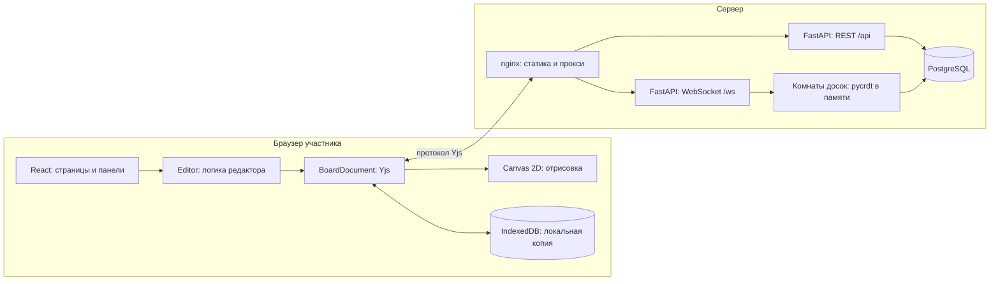

# Архитектура Whatever

Документ описывает, как устроено приложение сейчас и почему выбраны именно такие решения.
Подробное техническое задание и план развития — в концепции проекта.

## Общая схема

Все сервисы поднимаются одной командой `docker compose up` на сервере заказчика.

## Модель данных доски

Доска — документ [Yjs](https://docs.yjs.dev) (CRDT). Каждый элемент хранится в своём `Y.Map`
внутри общего `Y.Map("elements")`:

- фигура: `rectangle`, `ellipse`, `diamond`, `text` или `path` (рукописный штрих) с рамкой
  `x, y, w, h`, текстом, цветами и порядком `z`;
- стрелка: два конца, каждый — свободная точка или привязка к фигуре (`shapeId`).

Так правки разных полей одного элемента от разных людей сливаются без конфликтов: один
двигает фигуру, другой меняет её текст, и оба изменения сохраняются. Типы описаны
в `frontend/src/model/types.ts`.

## Фронтенд

Слои зависят только от нижележащих:

| Слой | Папка | Что делает |
| --- | --- | --- |
| Модель | `src/model` | `BoardDocument` поверх Yjs, геометрия, поиск элементов под курсором |
| Распознавание | `src/recognition` | превращает штрих в фигуру или линию и выравнивает её |
| Редактор | `src/editor` | инструменты, выделение, перетаскивание, отмена, горячие клавиши; без React и DOM |
| Холст | `src/canvas` | камера, сетка, отрисовка кадра, события указателя |
| Совместная работа | `src/collab` | подключение к серверу, локальная копия, присутствие участников |
| Интерфейс | `src/pages`, `src/ui` | страницы, панель инструментов, навигация |

`Editor` не знает о React и DOM: он получает события в экранных координатах и меняет
документ, камеру и выделение. Поэтому почти вся логика проверяется быстрыми юнит-тестами,
без браузера.

### Производительность

- Холст перерисовывается в `requestAnimationFrame` только при изменениях (флаг «грязного» кадра).
- Рисуются только элементы, попавшие в видимую область.
- `BoardDocument` держит неизменяемый снимок элементов и пересобирает его только после
  изменения документа, а не на каждый кадр или движение мыши.
- React перерисовывает панели, только когда меняется то, что они показывают
  (инструмент, выделение, масштаб), а не на каждое движение указателя.
- Положение курсора отправляется другим участникам не чаще 20 раз в секунду.
- Распознавание фигур работает в браузере и не нагружает сервер.

### Умное рисование

Штрих передискретизируется до 64 точек и сравнивается с идеальными прямоугольником, эллипсом,
ромбом и прямой. Если ошибка подгонки меньше порога, набросок заменяется ровной фигурой:
почти квадрат становится квадратом, размер берётся у похожего соседа, центр выравнивается
по соседям, остальное ставится по сетке. Прямая у фигуры превращается в привязанную стрелку.
Замена — отдельный шаг отмены, поэтому первое Ctrl+Z возвращает рукописный вариант.

## Совместная работа

Клиент — стандартный `y-websocket`, сервер реализует тот же протокол на `pycrdt`:

1. При подключении сервер отправляет вектор состояния, клиент досылает недостающие изменения
   и получает недостающие у себя.
2. Дальше каждое изменение рассылается остальным участникам комнаты.
3. Присутствие (имя, цвет, курсор, выделение) идёт через awareness и в документ не попадает.

**Работа без сети.** Документ хранится в IndexedDB, доска открывается сразу и редактируется
без связи. После переподключения протокол Yjs сам объединяет изменения, сделанные за это время.

**Чужим данным не доверяем.** Элементы документа и присутствие других участников приходят
по сети, поэтому проверяются при чтении (`src/model/validate.ts`): элемент с битыми полями
пропускается и не ломает доску у всех участников.

**Права и вход** появятся следующим этапом: свои учётные записи, которые создаёт администратор,
и подключаемые способы входа (AD, Keycloak) на будущее.

## Бэкенд

| Модуль | Что делает |
| --- | --- |
| `app/api/boards.py` | REST: список, создание, переименование, удаление досок |
| `app/api/sync.py` | WebSocket `/ws/boards/{id}`: подключение участника к комнате |
| `app/sync/room.py` | комнаты досок: документ в памяти, рассылка, запись в базу |
| `app/models.py` | таблицы `users`, `boards`, `board_updates` |

Всё асинхронное: FastAPI, SQLAlchemy 2 с `asyncpg`, отдельный поток на запрос не нужен.

### Хранение доски

Доска хранится как последовательность двоичных дельт Yjs в `board_updates`. При открытии
комнаты дельты применяются по порядку.

- **Запись пачками.** Изменения за 0,5 секунды объединяются (`merge_updates`) и пишутся одной
  строкой. Перетаскивание фигуры даёт десятки изменений в секунду; без пачек это были бы
  тысячи вставок в секунду при сотне участников.
- **Почему это безопасно.** Если сервер упадёт до записи пачки, изменения не потеряются:
  они есть у клиентов, и при переподключении клиент досылает серверу всё, чего у того нет.
  При штатной остановке сервер дописывает всё несохранённое.
- **Сжатие.** Когда последний участник уходит, а дельт накопилось больше 50, они заменяются
  одним снимком документа, и доска открывается быстрее. Если документ не загрузился
  (например, база была недоступна), сжатие не выполняется, чтобы не стереть историю.

### Конкурентность

`RoomManager` хранит открытые комнаты. Общая блокировка защищает только словарь комнат
и списки участников: загрузка доски из базы и отправка данных клиентам идут вне её,
поэтому медленная доска или медленный клиент не задерживают остальных. Новая сессия доски
ждёт, пока предыдущая допишет изменения в базу.

### Ограничения текущей версии

- Комнаты живут в памяти одного процесса, поэтому бэкенд запускается одним процессом
  `uvicorn`. Для 100 одновременных участников этого должно хватить, но нагрузочный тест
  ещё не проводился, он в плане. Для нескольких процессов
  или серверов комнаты будут обмениваться изменениями через Redis pub/sub (Redis уже есть
  в `docker-compose.yml`).
- Название доски меняется через REST и у других участников обновляется при следующем открытии.

## Качество кода

Проверки запускаются в CI на каждый pull request; локально — те же команды.

| Часть | Проверки |
| --- | --- |
| Бэкенд | `ruff` (линтер и форматирование), `mypy --strict`, `pytest` с покрытием не ниже 90%, предупреждения считаются ошибками |
| Миграции | применение, откат и повторное применение на настоящем PostgreSQL 16 |
| Фронтенд | Prettier, ESLint (`strictTypeChecked`), TypeScript `strict` и `noUncheckedIndexedAccess`, Vitest с порогами покрытия, сборка |
| Docker | сборка образов |

Синхронизация проверяется тестами на обоих концах: на бэкенде настоящими клиентами pycrdt
по протоколу Yjs, на фронтенде сессией с управляемым WebSocket.
